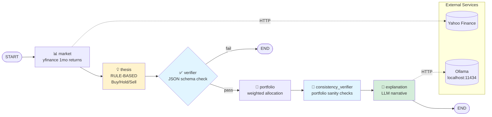
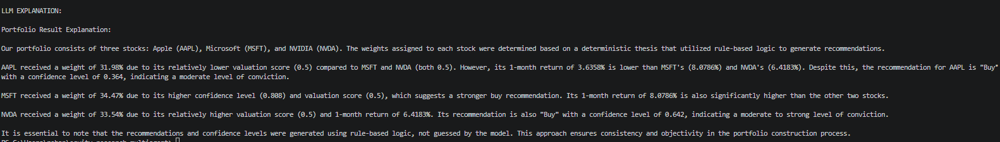
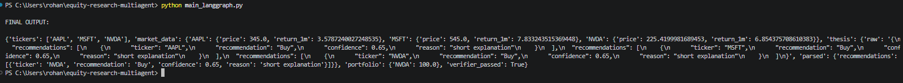

# 📈 Equity Research Multi-Agent System

A **hybrid deterministic + LLM** equity research pipeline built with
**LangGraph**, **Ollama**, and **yfinance**.

The core stock scoring is **fully deterministic** (no LLM hallucination),
while a local **Ollama LLM** writes the final human-readable explanation.

[](https://www.python.org/)
[](https://github.com/langchain-ai/langgraph)
[](https://ollama.com)
[](LICENSE)

---

## 🎯 What It Does

Given a list of stock tickers, the pipeline:

1. Fetches 1-month price data via **yfinance**
2. Produces **rule-based** Buy / Hold / Sell recommendations with confidence scores
3. Validates the thesis structure with a **verifier**
4. Computes a **weighted portfolio allocation**
5. Runs **consistency checks** on the portfolio (sum, misalignment, pair-wise logic)
6. Uses **Ollama** to write a professional narrative explanation

No API keys. No cloud. Runs entirely on your machine.

---

## 🏗️ Orchestration Architecture



> 📖 Full breakdown → [`docs/architecture.md`](docs/architecture.md)

---

## 🧠 Agents at a Glance

| # | Node | Type | Role | Writes to state |
|---|------|------|------|-----------------|
| 1 | `market` | **Deterministic** | Fetch 1-month OHLC via yfinance | `market_data` |
| 2 | `thesis` | **Deterministic** | Rule-based Buy/Hold/Sell + confidence | `thesis` |
| 3 | `verifier` | **Deterministic** | JSON schema validation | `verifier_passed` |
| 4 | `portfolio` | **Deterministic** | Weighted allocation | `portfolio` |
| 5 | `consistency_verifier` | **Deterministic** | Portfolio sanity checks | `portfolio_checks` |
| 6 | `explanation` | 🧠 **LLM** | Writes narrative | `explanation` |

**Only 1 of 6 nodes calls an LLM** — the rest are pure Python. This makes the
output **reproducible and auditable**.

---

## 📐 The Rules (Deterministic Logic)

### Recommendation (from 1-month return)

```python
if return_1m < -5:      return "Sell"
elif return_1m <= 2:    return "Hold"
else:                   return "Buy"
```

### Confidence

```python
confidence = min(abs(return_1m) / 10, 1.0)
```

### Valuation score (from P/E)

| P/E | Score |
|-----|-------|
| `< 20` | 0.8 |
| `< 35` | 0.6 |
| else | 0.3 |
| missing | 0.5 |

### Portfolio scoring

```
score = recommendation * 0.5 + confidence * 0.3 + valuation * 0.2
weight = score / sum(scores) * 100
```

Where `recommendation ∈ {Buy:3, Hold:2, Sell:1}`.

### Consistency checks

- Weights should sum to ≈ 100%
- `Sell` ratings should not exceed 40% weight
- `Buy` ratings should not be under 10% weight
- Low confidence (< 0.30) should not get > 35% weight
- Pair-wise: if T1 is stronger than T2, T1 should not weigh 5%+ less than T2

---

## 🚀 Quick Start

### Prerequisites

- Python **3.11+**
- **[Ollama](https://ollama.com)** installed and running

### 1. Pull the model

```bash
ollama pull llama3.2:3b
ollama serve
```

### 2. Clone & install

```bash
git clone https://github.com/<your-username>/equity-research-multiagent.git
cd equity-research-multiagent

python -m venv venv
source venv/bin/activate          # Windows: venv\Scripts\activate

pip install -r requirements.txt
```

### 3. Run

```bash
python app/graph_workflow.py
```

Output:

```
Running market_data_node....
Running thesis_node....
Running verifier_node...
Running portfolio_node...
Running Explanation_node...

FINAL OUTPUT:
{ ... }

LLM EXPLANATION:
Based on the 1-month return of +X%, AAPL received a Buy recommendation...

```




---

## 📂 Project Structure

```
equity-research-multiagent/
│
├── app/
│   └── graph_workflow.py       # ← main graph (6 nodes)
├── main_langgraph.py           # CLI alternative entry point
├── streamlit_app.py            # (optional) web UI
│
├── docs/
│   └── architecture.md
│
├── tests/
│   └── test_graph.py
│
├── requirements.txt
├── .gitignore
├── LICENSE
└── README.md
```

---

## 🧪 Testing

```bash
pytest tests/ -v
```

---

## 🛠️ Tech Stack

| Layer | Technology |
|-------|-----------|
| Orchestration | **LangGraph** |
| LLM (explanation only) | **Ollama** + `langchain-ollama` |
| Market Data | **yfinance** |
| State | Python `TypedDict` |

---

## 🗺️ Roadmap

- [ ] Add P/E ratio to `market_data` (currently `pe` is looked up but never populated)
- [ ] Move `llm = ChatOllama(...)` inside `build_graph()` so model/temp are configurable
- [ ] Add `max_retries` counter if the verifier loop is reintroduced
- [ ] Cache yfinance responses to avoid rate limits
- [ ] Structured output via `.with_structured_output()` instead of raw JSON parsing
- [ ] Streamlit UI (already drafted in `streamlit_app.py`)

---

## ⚠️ Disclaimer

**Educational use only.** Not financial advice.
The deterministic rules are intentionally simple and are **not** a trading strategy.

---

## 📜 License

MIT — see [LICENSE](LICENSE).